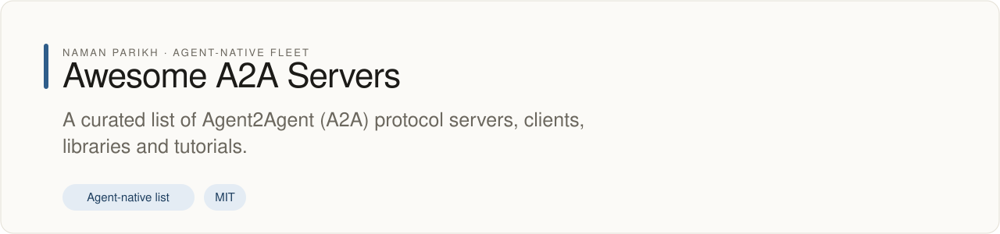

# Awesome A2A Servers [](https://awesome.re)

<!-- fleet:header:start -->
<p align="center"><picture><source media="(prefers-color-scheme: dark)" srcset="assets/banner-dark.svg"></picture></p>

<p align="center">
<a href="https://github.com/naman10parikh/awesome-a2a-servers/releases"></a>
<a href="LICENSE"></a>
<a href="https://x.com/naman10parikh"></a>
<a href="https://www.linkedin.com/in/naman-parikh1/"></a>
</p>

<p align="center"><a href="https://github.com/naman10parikh/awesome-a2a-servers/discussions">Discussions</a> · <a href="https://github.com/naman10parikh">All projects</a></p>

**A curated list of Agent2Agent (A2A) protocol servers, clients, libraries and tutorials.**

An agent-native list: written for people and kept machine-readable for agents, with [AGENTS.md](AGENTS.md) and [llms.txt](llms.txt) telling an agent how to read and extend it.

_Awesome A2A Servers is part of an agent-native play for agent-native systems that can eventually be recursively self-improving and evolving, operated by agent employees._
<!-- fleet:header:end -->


A curated list of awesome Agent-to-Agent (A2A) Protocol servers.

* [What is A2A?](#what-is-a2a)
* [Clients](#clients)
* [Tutorials & Learning Resources](#tutorials--learning-resources)
* [Server Implementations](#server-implementations)
* [Frameworks](#frameworks)
* [Utilities](#utilities)
* [Documentation](#documentation)
* [Tips & Tricks](#tips--tricks)

<!-- fleet:use:start -->
## Use it from any coding agent

Codex, Cursor, OpenCode, GitHub Copilot and other agents read [AGENTS.md](AGENTS.md); 
<!-- fleet:use:end -->

## What is A2A?

A2A (Agent-to-Agent) is an open protocol initiated by Google that enables communication and interoperability between AI agents built on different frameworks or by different vendors. The core goal is to allow agents to discover each other's capabilities, negotiate interaction modes (text, forms, files, etc.), and collaborate securely on tasks.

## Official Resources

* [A2A Protocol GitHub Repository](https://github.com/google/A2A) - Google's official repository for A2A protocol
* [A2A Specification](https://github.com/google/A2A/blob/main/specification/json/a2a.json) - JSON Schema defining A2A protocol

## Clients

* Check out sample clients in the [official A2A repository](https://github.com/google/A2A/tree/main/samples)
* 📇 [A2A CLI](https://github.com/chrishayuk/a2a-cli) - Command-line client for interacting with A2A servers
* 📇 [A2A UI](https://github.com/egor-baranov/a2a-ui) - UI for Google A2A made using Next.js, TypeScript and Shadcn
* 🏎️ [ka](https://github.com/tot-ra/ka) - AI agent accessible via CLI or network, A2A compatible

## Tutorials & Learning Resources

* [Getting Started with A2A Protocol](https://github.com/google/A2A#getting-started) - Official getting started guide
* 📇 [A2A & MCP Tutorial](https://github.com/Tsadoq/a2a-mcp-tutorial) - A tutorial on how to use Model Context Protocol by Anthropic and Agent2Agent Protocol by Google
* 🐍 [A2A ADK MCP Tutorial](https://github.com/RubensZimbres/A2A_ADK_MCP) - Multi-Agent Systems with Google's Agent Development Kit + A2A + MCP
* 🐍 [Learn Agentic AI](https://github.com/panaversity/learn-agentic-ai) - Learn Agentic AI using Dapr Agentic Cloud Ascent (DACA) Design Pattern: OpenAI Agents SDK, Memory, MCP, A2A, Knowledge Graphs, Rancher Desktop, and Kubernetes
* 📇 [A2A Samples](https://github.com/theailanguage/a2a_samples) - Samples for A2A implementation
* 📇 [A2A Example](https://github.com/s-hiraoku/a2a-example) - Example implementation of A2A protocol
* 📇 [A2A MCP Express.js](https://github.com/SteffenHebestreit/a2a_mcp_express.js) - This repository implements a Node.js AI agent using Express, LangChain, the Model Context Protocol (MCP), and the Agent-to-Agent (A2A) protocol
* 📇 [A2A TS Examples](https://github.com/alkimiadev/A2A-ts-examples) - TypeScript examples for A2A implementation
* 📇 [A2A Walk Through](https://github.com/KelvinQiu802/a2a-walk-through) - A2A Concept walkthrough
* 📇 [A2A Demo](https://github.com/ParadeTo/a2a-demo) - A2A Demo implementation
* 🐍 [Google A2A Sample](https://github.com/meetrais/google-a2a-sample) - Sample implementation of Google's A2A protocol
* 🐍 [AI MCP Study](https://github.com/jungyu/AI-MCP-Study) - Collection of AI and MCP (Model Control Protocol) related demonstrations and implementations
* 🐍 [Azure OpenAI LLM Cookbook](https://github.com/kimtth/azure-openai-llm-cookbook) - A one-stop hub with 100+ Azure OpenAI sample code organized by topic for quick reference
* 🐍 [Learning Notes](https://github.com/kyong0612/learning-notes) - Notes on books, talks, articles, papers, and practice playgrounds
* 🐍 [LLM Tutorials](https://github.com/worldluoji/LLM-Tutorials) - AI drawing learning guide
* 🐍 [AI Batch Learning Resources](https://github.com/hassan-ak/AI_201-Batch_67-Q2-Certified_Agentic_Robotic_AI_Engineer) - Learning resources for AI certification
* 📇 [Techie Talks AI](https://github.com/schogini/techietalksai) - Techie Talks AI Youtube Channel code repository
* 🐍 [DeepSeek Implementation](https://github.com/xingyunyang01/Geek02) - DeepSeek application development course companion code

## Legend

* 🎖️ – official implementation
* programming language  
   * 🐍 – Python codebase  
   * 📇 – TypeScript/JavaScript codebase  
   * 🏎️ – Go codebase  
   * 🦀 – Rust codebase  
   * #️⃣ - C# Codebase  
   * ☕ - Java codebase
   * 💎 - Kotlin codebase
   * 💧 - Elixir codebase
* scope  
   * ☁️ - Cloud Service  
   * 🏠 - Local Service
* operating system  
   * 🍎 – For macOS  
   * 🪟 – For Windows
   * 🐧 – For Linux

## Server Implementations

Below is a list of A2A server implementations, categorized by their primary function. Want to add your own? [Contributions are welcome!](CONTRIBUTING.md)

### 🎖️ Official Implementations

> Implementations provided in the official Google A2A repository.

* 🎖️ [Google A2A](https://github.com/google/A2A) - An open protocol enabling communication and interoperability between opaque agentic applications
* 🐍 [ADK Agent](https://github.com/google/A2A/tree/main/samples/python/agents/google_adk) - Sample agent built with Google's Agent Developer Kit (ADK) that handles expense reports
* 🐍 [LangGraph Agent](https://github.com/google/A2A/tree/main/samples/python/agents/langgraph) - Currency conversion agent built with LangGraph (demonstrates financial tools)
* 🐍 [CrewAI Agent](https://github.com/google/A2A/tree/main/samples/python/agents/crewai) - Image generation agent built with CrewAI
* 📇 [Genkit Movie Agent](https://github.com/google/A2A/tree/main/samples/js/src/agents/movie-agent) - Movie information agent built with Genkit (demonstrates search/data extraction)
* 📇 [Genkit Coder Agent](https://github.com/google/A2A/tree/main/samples/js/src/agents/coder) - Code generation agent built with Genkit (demonstrates developer tools)

### 🤖 Browser Automation

> Servers for controlling and automating web browsers.

* 📇 [Grasp](https://github.com/aircodelabs/grasp) - Self-hosted agentic browser with built-in MCP, A2A support

### 💼 Business & Productivity Tools

> Servers interfacing with common business software like CRMs, ERPs, project management tools, calendars, etc.

* 🐍 [A2A MCP Demo](https://github.com/doogie-bigmack/a2a_mcp_demo) - A2A and MCP agent demo showing integration with business systems
* 📇 [Social Media Poster](https://github.com/nexio-t/social-media-poster) - Social media posting automation tool
* 📇 [TSOA MCP](https://github.com/BitHighlander/tsoa-mcp) - TSOA-based Model Context Protocol implementation
* 🐍 [Atlas Backend](https://github.com/KB01111/Atlas-Backend) - Backend server for Atlas productivity platform

### 💬 Communication Services

> Servers for messaging, email, notifications, and other communication tools.

* 📇 [A2AChat](https://github.com/Web-Engine/A2AChat) - A2A-compatible chat application
* 📇 [Swissknife](https://github.com/daltonnyx/swissknife) - Chat application with multi-agents system supporting multiple models and MCP
* 📇 [TKR Agent Chat](https://github.com/TuckerTucker/tkr-agent-chat) - Agent-based chat implementation
* 📇 [Gemini A2A Chat](https://github.com/jeantimex/gemini-a2a-chat) - Node.js chat app using Gemini function calling and an A2A server to interact with Google Maps APIs
* 🐍 [AMAZ](https://github.com/Ivankilin/AMAZ) - Communication platform for agent interactions

### 📊 Data Analysis & Database Integration

> Servers for data processing, analytics, querying databases, or interacting with BI tools.

* 🐍 [Database Agent](https://github.com/wognsths/Database-Agent) - Database Agent using A2A architecture
* 📇 [Search API](https://github.com/krickert/search-api) - Search API for the vector-based search engine ecosystem
* 📇 [MCP Smanetting](https://github.com/salvatorelaspata/mcp-smanetting) - Data integration service using MCP

### 🧬 Data Science & Machine Learning

> Servers providing tools for data science workflows, model training, or ML operations.

* 🐍 [Agentic RAG](https://github.com/heyibad/agentic-rag) - AGENTIC RAG with OpenAI Agent SDK, Qdrant DB, and Chainlit
* 🐍 [Weekly arXiv ML AI Research Review](https://github.com/Verbasik/Weekly-arXiv-ML-AI-Research-Review) - Weekly collection of arXiv paper reviews in machine learning and AI

### 🛠️ Developer Tools

> Servers for software development tasks, code generation, version control interaction, code execution, and DevOps.

* 📇 [A2A Agent Coder](https://github.com/sing1ee/a2a-agent-coder) - A2A agent coder by OpenRouter
* 🐍 [Cognisphere](https://github.com/IhateCreatingUserNames2/Cognisphere) - Cognisphere ADK is an AI agent development framework built on Google's Agent Development Kit (ADK)
* 📇 [A2A Server](https://github.com/chrishayuk/a2a-server) - A2A server implementation
* 📇 [A2A Server by iamarcel](https://github.com/iamarcel/a2a-server) - Another A2A server implementation
* 🐍 [UE5Test](https://github.com/jjh2v287/UE5Test) - Unreal Engine 5 testing with A2A protocol

### 💰 Financial Services

> Servers for financial operations, currency conversion, and financial data.

* 🐍 [Smart Crypto Portfolio Manager](https://github.com/tonycai/smart_crypto_portfolio_manager) - A sophisticated multi-agent system for intelligent cryptocurrency portfolio management using A2A communication
* 📇 [Tradeline AI](https://github.com/RibbonBlockchain/TradelineAI) - Credit Economy for AI Agents
* 📇 [BSV-MCP](https://github.com/b-open-io/bsv-mcp) - An MCP Server for Bitcoin SV

### 🧠 Knowledge & Research

> Servers for knowledge management, research, and information processing.

* 🐍 [A2A Directory](https://github.com/sing1ee/a2a-directory) - Agent2Agent (A2A) – AgentCards, Servers, Clients, Docs
* 🐍 [A2A Docu Scraper](https://github.com/nkeneng/a2a-docu-scraper) - Script that scrapes Google's A2A protocol documentation
* 📇 [Shoggoth Industries](https://github.com/shoggoth-industries/shoggoth.industries) - Knowledge management platform for AI research
* 🐍 [Toolkit](https://github.com/richzw/ToolKit) - Knowledge self-learning toolkit
* 📇 [All Things Connected](https://github.com/Mon8Cats/all-things-connected) - Knowledge connection system

### 🖼️ Image & Media Generation

> Servers for generating images, videos, audio, or other media.

* 🐍 [Movie Script Generator](https://github.com/nevermined-io/movie-script-generator-agent-crew-ai) - A2A server for generating movie scripts using AI technology for crew members in Nevermined platform

### 🔄 Integration Services

> Servers that act as bridges or gateways to various APIs, platforms, and services.

* 📇 [n8n-nodes-agent2agent](https://github.com/pjawz/n8n-nodes-agent2agent) - Adds nodes to n8n for interacting with AI agents using A2A protocol
* 🏎️ [Agent Gateway](https://github.com/agentgateway/agentgateway) - Next Generation Agentic Proxy for API integrations
* 🐍 [EC2 Creation MCP Tool](https://github.com/anirban1592/google_openai_mcp) - Demonstrates how Google's A2A protocol works with Anthropic's MCP protocol for AWS EC2 creation
* 📇 [Agent Central](https://github.com/heyitsaamir/agent-central) - Agent Central for all the agents
* 🏎️ [A2A Ollama](https://github.com/CorticalFlow/a2a-ollama) - Integration of A2A protocol with Ollama
* 📇 [Confluentinc Agent Proxy](https://github.com/confluentinc/agent_proxy) - Agent proxy for Confluent
* 🐍 [Pepper AI Samples](https://github.com/felipepimentel/pepper-ai-samples) - Integration samples for Pepper AI platform
* 📇 [Google Agent 2 Agent](https://github.com/amilaperera97/google-agent-2-agent) - Google Agent-to-Agent protocol implementation

### 🗺️ Location Services

> Servers providing geospatial data, mapping, directions, and place information.

* 🐍 [Google Maps A2A Server](https://github.com/pab1it0/google-maps-a2a) - An A2A-compliant server that provides Google Maps capabilities
* 📇 [Google Maps A2A Server by jeantimex](https://github.com/jeantimex/google-maps-a2a-server) - Enables AI agents to use Google Maps features (geocoding, elevation, search, directions) via the A2A protocol

### 💊 Healthcare & Wellness

> Servers related to health data, fitness tracking, or wellness information.

* 📇 [Health Record MCP](https://github.com/jmandel/health-record-mcp) - Connect to an EHR and make clinical data available via MCP
* 🐍 [Happiness Agent](https://github.com/EdwardZehuaZhang/Happiness-Agent) - Agent focused on wellness and happiness

### 🔎 Search & Data Extraction

> Servers for web search, data retrieval, document querying, and information extraction.

* 📇 [PocketFlow-Tutorial](https://github.com/The-Pocket/PocketFlow-Tutorial-Codebase-Knowledge) - Turns GitHub repositories into easy tutorials with AI
* 🐍 [SOFIA](https://github.com/DevRickLin/Sofia) - S.O.F.I.A. - Search-Optimized Flow-based Intelligence Agent

### 📝 Blogging & Content

> Servers related to content management, blogging, and publishing.

* 📇 [Zenn Articles](https://github.com/shun0211/zenn-articles) - Content management for Zenn articles
* 📇 [Kaigai Matome](https://github.com/karintomania/kaigai-matome) - Content aggregation platform
* 📇 [My Public Notes](https://github.com/felipepimentel/my-public-notes) - Public note sharing platform
* 📇 [Wang Junjian GitHub.io](https://github.com/wang-junjian/wang-junjian.github.io) - Personal blog built with A2A capabilities
* 📇 [Ruxu.dev](https://github.com/rogiia/ruxu.dev) - Personal developer portfolio with A2A integration
* 📇 [LPF GitHub.io](https://github.com/lpflpf/lpflpf.github.io) - GitHub pages blog
* 📇 [Houbb GitHub.io](https://github.com/houbb/houbb.github.io) - 🧀 The blog for GitHub pages
* 📇 [Justin3go.com](https://github.com/Justin3go/justin3go.com) - A fully-featured modern blog based on VitePress
* 📇 [Einverne GitHub.io](https://github.com/einverne/einverne.github.io) - Personal blog using jekyll-bootstrap
* 📇 [Euler AI Blog](https://github.com/eulerai-au/blog) - Blog posts of Euler AI
* 📇 [Qiankunli GitHub.io](https://github.com/qiankunli/qiankunli.github.io) - Personal blog
* 📇 [TheSingularityReview](https://github.com/DevRickLin/TheSingularityReview) - AI-focused review platform
* 📇 [Elevate Human Experiences Blog](https://github.com/elevate-human-experiences/blog) - Blog focused on elevating human experiences
* 📇 [Hobby GitHub.io](https://github.com/hobbytp/hobbytp.github.io) - Personal hobby blog
* 📇 [KaptanDataSolutions GitHub.io](https://github.com/kaptandatasolutions/kaptandatasolutions.github.io) - Data solutions blog
* 📇 [Zenn Content](https://github.com/hachimada/zenn-content) - Content for Zenn platform
* 📇 [RSS Blog](https://github.com/sunrabbit123/rss-blog) - RSS-based blog platform

### 🧪 Experimental Implementations

> Experimental or specialized A2A server implementations.

* 🐍 [A2A PDLC Playground](https://github.com/egor-baranov/a2a-pdlc-playground) - A playground repository for A2A protocol implementation with Partially Signed Bitcoin Transactions (PSBT)
* 🐍 [A2A With MCP](https://github.com/anshulLuhsna/a2a_with_mcp) - Integration of A2A with MCP
* 🐍 [A2A Insecure Demo](https://github.com/kenhuangus/a2a-insecure-demo) - Demonstration of A2A protocol with insecure settings
* 📇 [A2A Sample](https://github.com/ryukez/a2a-sample) - Node.js sample code for A2A protocol
* 📇 [A2A MCP Tutorial](https://github.com/Tsadoq/a2a-mcp-tutorial) - A tutorial on how to use MCP and A2A Protocol
* 📇 [A2A Example](https://github.com/azukiazusa1/a2a-example) - Example implementation of A2A
* 📇 [Google A2A Agents](https://github.com/SunShade123456/google-a2a-agents) - Implementation of Google A2A protocol agents
* 📇 [A2A Demo by pierremellet](https://github.com/pierremellet/a2a-demo) - Demonstration of A2A protocol features
* 📇 [A2A ADK CrewAI Implementation](https://github.com/teeppp/a2a_adk_crewai_impl) - Implementation combining ADK and CrewAI with A2A
* 📇 [Backv2](https://github.com/aviadkim/backv2) - Experimental backend with A2A support
* 📇 [Caramba](https://github.com/TheApeMachine/caramba) - Experimental A2A implementation
* 📇 [MCP A2A](https://github.com/tesla0225/mcp-a2a) - Experimental MCP and A2A integration
* 📇 [Nuwa](https://github.com/rooch-network/nuwa) - Experimental A2A server for Rooch Network

### 🌐 General Purpose Implementations

> General purpose A2A server implementations.

* 🏎️ [A2A Go](https://github.com/TheApeMachine/a2a-go) - A2A server in Go for facilitating communication between software agents
* 🏎️ [Co-browser A2A Go](https://github.com/co-browser/a2a-go) - Free your agents - a Go implementation of the A2A protocol from Google
* 🏎️ [A2A Go by sammcj](https://github.com/sammcj/go-a2a) - Another Go implementation of A2A protocol
* 🏎️ [A2A Go by thinkovation](https://github.com/thinkovation/go-a2a) - Go implementation of A2A
* 🏎️ [A2A Server](https://github.com/a2aserver/a2a-go) - Google A2A Server in Go
* 🏎️ [TRPC A2A Go](https://github.com/trpc-group/trpc-a2a-go) - Go implementation for A2A (Agent2Agent) protocol
* 🏎️ [WineChord TRPC A2A Go](https://github.com/WineChord/trpc-a2a-go) - TRPC-based Go implementation of A2A
* 🦀 [A2A Rust](https://github.com/robert-at-pretension-io/A2A) - Rust A2A tools for the greater good
* 📇 [A2A SDK by ryukez](https://github.com/ryukez/a2a-sdk-ryukez) - A2A (Agent-to-Agent) SDK sample for Node.js
* #️⃣ [A2A DotNet](https://github.com/marius-bughiu/A2ADotNet) - A2A client library for .NET
* #️⃣ [A2A DotNet by azixaka](https://github.com/azixaka/a2adotnet) - The Agent2Agent (A2A) protocol implementation for .NET
* ☕ [A2A Java](https://github.com/vishalmysore/a2ajava) - Pure Java implementation of Google A2A protocol for Spring Boot
* ☕ [A2A4J](https://github.com/imfangs/a2a4j) - A Java implementation of the A2A protocol
* ☕ [A2A4J by PheonixHkbxoic](https://github.com/PheonixHkbxoic/a2a4j) - A Java implementation of the A2A protocol for agent-to-agent scenarios
* 💎 [A2A-4K](https://github.com/a2a-4k/a2a-4k) - Kotlin Implementation of the A2A Protocol
* 💧 [Ember Ex Elixir](https://github.com/jmanhype/ember_ex_elixir) - Elixir port of the Ember framework for building LLM applications
* 📇 [YAAP](https://github.com/bc3tech/yaap) - Definition, documentation, samples for Yet Another Agent Protocol (YAAP)
* 🐍 [A2A Min](https://github.com/pcingola/a2a_min) - Minimal A2A implementation
* 🐍 [A2A Agent](https://github.com/adriapedralbes/a2a-agent) - A2A protocol agent implementation
* 🐍 [A2A by dwoodard](https://github.com/dwoodard/a2a) - A2A implementation
* 🐍 [A2A by ovantee](https://github.com/ovantee/a2a) - Another A2A implementation
* 🐍 [A2A by mlaurel](https://github.com/mlaurel/A2A) - A2A protocol implementation
* 🐍 [A2A Instabids](https://github.com/JustinAIDistuptors/A2A-Instabids) - A2A implementation for Instabids
* 🐍 [AVA The AI Agent](https://github.com/kamalbuilds/ava-the-ai-agent) - AI agent implementation with A2A support
* 🐍 [Agent2Agent](https://github.com/HarleyCoops/Agent2Agent) - Implementation of the Agent-to-Agent protocol

### 🔬 Multi-Agent Systems

> Platforms for creating and managing multiple interacting agents.

* 🐍 [Noodle Engineer](https://github.com/NoodleSeed-com/noodle-engineer) - A2A server for NoodleSeed-com's engineering platform, facilitating agent communication and collaboration in projects
* 📇 [SynaptiCore](https://github.com/insomniac-klutz/SynaptiCore) - Genesis Playground <> Automation Agents
* 📇 [A2AFlow](https://github.com/closedloop-technologies/A2AFlow) - A2A protocol server for data flow management
* 🐍 [A2A LangGraph](https://github.com/Coding-Crashkurse/A2A-LangGraph) - A2A implementation using LangGraph
* 🐍 [Google ADK A2A MCP](https://github.com/karthmnz/google-adk-a2a-mcp) - Integration of Google ADK with A2A and MCP
* 🐍 [Ottomator Agents](https://github.com/coleam00/ottomator-agents) - Open source AI Agents hosted on the oTTomator Live Agent Studio platform
* 🐍 [Agent Network Protocol](https://github.com/agent-network-protocol/AgentNetworkProtocol) - Open source protocol for agent communication, defining how agents connect with each other
* 🐍 [A2A Tutor](https://github.com/dpolishuk/a2a-tutor) - Tutoring system using A2A protocol
* 🐍 [Tutor Agent](https://github.com/labKnowledge/tutor_agent) - Agent for tutoring using A2A
* 🐍 [AI Agent2Agent](https://github.com/labKnowledge/ai_agent2agent) - Implementation of agent-to-agent communication
* 🐍 [TARS](https://github.com/GuitarAlchemist/tars) - Multi-agent system for guitar-related applications

## Frameworks

* 🎖️ [Google ADK](https://github.com/google/A2A/tree/main/samples/python/agents/google_adk) - Google's Agent Developer Kit with A2A support
* 🎖️ [LangGraph](https://github.com/google/A2A/tree/main/samples/python/agents/langgraph) - Framework for building stateful, multi-step agents
* 🎖️ [CrewAI](https://github.com/google/A2A/tree/main/samples/python/agents/crewai) - Framework for creating and orchestrating role-playing agents
* 🎖️ [Genkit](https://github.com/google/A2A/tree/main/samples/js/src/agents) - JavaScript framework for building generative AI applications
* 🐍 [Mentis](https://github.com/foreveryh/mentis) - A powerful multi-agent orchestration framework built on LangGraph
* 🐍 [Qredence Agentic-Kernel](https://github.com/Qredence/Agentic-Kernel) - A flexible foundation AI system for creating A2A-compatible autonomous AI agents
* 🐍 [PocketFlow](https://github.com/The-Pocket/PocketFlow) - Pocket Flow: 100-line LLM framework that lets agents build agents
* 📇 [Agent Hub](https://github.com/chandrakanthm/agentHub) - Keeps AI agents discoverable, composable, and resilient
* 📇 [AI Mocks](https://github.com/mokksy/ai-mocks) - Mock HTTP/SSE and LLM servers, inspired by wiremock, with response streaming and SSE
* 📇 [Artinet SDK](https://github.com/the-artinet-project/artinet-sdk) - A JS/TS SDK for the Agent2Agent Protocol
* 🐍 [MCP/A2A](https://github.com/tesla0225/mcp-a2a) - MCP and A2A integration framework
* 🐍 [Claude MCP](https://github.com/cnych/claude-mcp) - Claude Unified Model Context Interaction Protocol
* 🐍 [Selector Plus](https://github.com/automateyournetwork/SelectorPlus) - Selector Plus - An MCP Implementation
* 🐍 [MCPyATS](https://github.com/automateyournetwork/MCPyATS) - VibeOps - Cisco pyATS MCP Plus Many Other MCPs
* 🐍 [MCP-O](https://github.com/danja/mcp-o) - MCP-based orchestration framework

## Utilities

### Libraries

* 🎖️ 🐍 [Python Common Library](https://github.com/google/A2A/tree/main/samples/python/common) - Python implementation of A2A client and server components
* 🎖️ 📇 [JavaScript Common Library](https://github.com/google/A2A/tree/main/samples/js/src) - JavaScript/TypeScript implementation of A2A client and server components
* 🏎️ [A2A Go by TheApeMachine](https://github.com/TheApeMachine/a2a-go) - A2A server in Go for facilitating communication between software agents
* 📇 [NestJS A2A](https://github.com/thestupd/nestjs-a2a) - A NestJS library for implementing Google's Agent-to-Agent (A2A) protocol
* ☕ [A2A4J](https://github.com/imfangs/a2a4j) - A Java implementation of the A2A protocol
* #️⃣ [A2A Net](https://github.com/neuroglia-io/a2a-net) - .NET implementation of the A2A protocol to enable secure, interoperable communication
* 🏎️ [TRPC A2A Go](https://github.com/trpc-group/trpc-a2a-go) - Go implementation for A2A protocol
* 🦀 [A2A RS](https://github.com/EmilLindfors/a2a-rs) - A2A Protocol implementation for Rust

### Tools

* 🎖️ 🐍 [Python CLI](https://github.com/google/A2A/tree/main/samples/python/hosts/cli) - Command-line tool to interact with A2A servers
* 🎖️ 📇 [JavaScript CLI](https://github.com/google/A2A/tree/main/samples/js/src/cli.ts) - JavaScript command-line tool for interacting with A2A servers
* 🎖️ 🐍 [Orchestrator Agent](https://github.com/google/A2A/tree/main/samples/python/hosts/multiagent) - An agent that can delegate tasks to remote agents through A2A
* 📇 [A2A UI](https://github.com/egor-baranov/a2a-ui) - UI for Google A2A made using Next.js, TypeScript and Shadcn
* 🏎️ [ka](https://github.com/tot-ra/ka) - AI agent accessible via CLI or network, A2A compatible
* 🐍 [A2A Code Along](https://github.com/harshsondhi/a2acodeAlong) - Code along examples for A2A
* 🐍 [A2A Learning](https://github.com/mbaneshi/a2a-learning) - Repository for learning and mastering the A2A protocol
* 🐍 [A2A Test](https://github.com/mkataigi/a2a-test) - Testing implementation for A2A protocol
* 🐍 [PR Agent Mentoring](https://github.com/ossca-2025/pr-agent-mentoring) - Pull request agent for code reviews and mentoring

## Documentation

* 📝 [A2A Docs ZH](https://github.com/sxhxliang/A2A-docs-zh) - Agent2Agent Protocol (A2A) Chinese documentation
* 📝 [A2A ZH](https://github.com/dushaobindoudou/a2a-zh) - Chinese documentation for A2A protocol
* 📝 [A2A by agentdevhub](https://github.com/agentdevhub/A2A) - Chinese documentation for Google's Agent2Agent protocol
* 📝 [Agent Rank](https://github.com/0xIntuition/agent-rank) - Documentation about agent ranking
* 📝 [AgSLAG Docs](https://github.com/KooshaPari/agslag-docs) - Documentation for agent systems
* 📝 [Qredence Documentation](https://github.com/Qredence/documentation) - Documentation for Qredence AI Intelligent solutions

## Tips & Tricks

### Setting Up Your First A2A Server

1. Clone the official A2A repository:
   ```bash
   git clone https://github.com/google/A2A.git
   ```
2. Choose one of the sample agents based on your preferred framework
3. Follow the setup instructions in the agent's README file
4. Use one of the CLI tools to interact with your agent

## Contributing

Please read the [contribution guidelines](CONTRIBUTING.md) before submitting a pull request.


<!-- fleet:anatomy:start -->
## What it is made of

Every project in this fleet is graded on the same 11 harness components and on self-improvement. Each mark is backed by a file you can open.

| Component | Grade | Where |
| --- | --- | --- |
| Identity | n/a | a list, not an agent employee: it has no persona |
| Memory | n/a | nothing to remember between runs; list.json is the data |
| Skills | n/a | a list ships no skills |
| Tools/CLIs | n/a | no command-line tool by design; tools/build-data.mjs:1 is the build and check script |
| Hooks | n/a | a list needs none |
| Sub-agents | n/a | a list needs none |
| MCPs | n/a | no MCP server by design |
| Dispatch | ✅ | .github/workflows/refresh.yml:6 (weekly cron and manual dispatch) |
| Evals | ✅ | .github/workflows/ci.yml:19 (the checker's 8 tests, then the list check; a failure blocks the merge) |
| Observability | n/a | nothing runs that needs a trail; the weekly run summary is the list's health report |
| Sandbox/Infra | n/a | nothing executes |
| Self-improvement | 🟡 | .github/workflows/refresh.yml:33 (weekly: new A2A projects and dead links, for a person to act on; no dsip.json) |

✅ real and tested · 🟡 partial, with the reason in the row · ❌ absent
<!-- fleet:anatomy:end -->


<!-- fleet:footer:start -->
## Part of a fleet

One of the projects by [Naman Parikh](https://github.com/naman10parikh). Each owns one part of an agent's harness, or of the product around an agent, and all of them follow one standard.

| Related project | What it owns |
| --- | --- |
| [AgentDial](https://github.com/naman10parikh/agentdial) | Identity |
| [WikiMem](https://github.com/naman10parikh/wikimem) | Memory |
| [Skillsmith](https://github.com/naman10parikh/skillsmith) | Skills |
| [Agent Booster](https://github.com/naman10parikh/agent-booster) | Tools / CLIs |
| [Hooksmith](https://github.com/naman10parikh/hooksmith) | Hooks |
| [AgentCast](https://github.com/naman10parikh/agentcast) | Sub-agents |
| [Plugsmith](https://github.com/naman10parikh/plugsmith) | Plugins |
| [Armory](https://github.com/naman10parikh/armory) | MCPs and the component registry |
| [AgentGrid](https://github.com/naman10parikh/agentgrid) | Dispatch |
| [AgentSwarm](https://github.com/naman10parikh/agentswarm) | Dispatch |
| [AgentBench](https://github.com/naman10parikh/agentbench) | Evals |
| [AgentMoney](https://github.com/naman10parikh/agentmoney) | Observability |
| [Sandforge](https://github.com/naman10parikh/sandforge) | Sandbox / Infra |
| [Claude Harness](https://github.com/naman10parikh/claude-harness) | The whole harness, as a template |

## Community

Questions and ideas go to [Discussions](https://github.com/naman10parikh/awesome-a2a-servers/discussions); bugs go to [issues](https://github.com/naman10parikh/awesome-a2a-servers/issues/new/choose). Follow the work on [X](https://x.com/naman10parikh) and [LinkedIn](https://www.linkedin.com/in/naman-parikh1/).

## Contributing and security

Read [CONTRIBUTING.md](CONTRIBUTING.md). AI-assisted pull requests are welcome. Report a vulnerability privately, as [SECURITY.md](SECURITY.md) explains.

## Star history

If it is useful to you, a star helps other people find it.

<a href="https://star-history.com/#naman10parikh/awesome-a2a-servers&Date"><picture><source media="(prefers-color-scheme: dark)" srcset="https://api.star-history.com/svg?repos=naman10parikh/awesome-a2a-servers&type=Date&theme=dark"></picture></a>

## Contributors

<a href="https://github.com/naman10parikh/awesome-a2a-servers/graphs/contributors"></a>
<!-- fleet:footer:end -->

## License

This repository is licensed under [MIT License](LICENSE).
