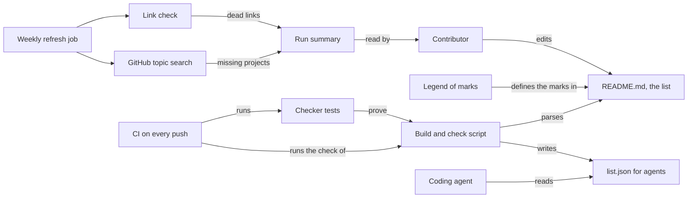

# How Awesome A2A Servers works

Awesome A2A Servers is a curated list of open-source projects that implement or use A2A. A2A (Agent2Agent) is an open protocol that lets agents built on different frameworks find each other and work together. The list is for developers looking for A2A servers, clients, libraries and tutorials. It is also for coding agents, which read the same entries as JSON. A script keeps the two forms in step, and CI checks every entry's format.

## The parts



[README.md](../README.md) is the one source. Its entries sit under seven `##` sections: Official Resources, Clients, Tutorials and Learning Resources, Server Implementations, Frameworks, Utilities and Documentation. Server Implementations and Utilities split further into `###` categories, such as Browser Automation. Each entry is one line with marks, a linked name and a short description. The marks come from the Legend section. They show an official project, documentation, the language, a cloud or local scope, and the operating system.

[tools/build-data.mjs](../tools/build-data.mjs) reads the README and writes [list.json](../list.json), one record per entry. [tools/build-data.test.mjs](../tools/build-data.test.mjs) proves that the checker catches each fault it promises to catch. [.github/workflows/ci.yml](../.github/workflows/ci.yml) runs both. [.github/workflows/refresh.yml](../.github/workflows/refresh.yml) looks for dead links and missing projects once a week. [AGENTS.md](../AGENTS.md) and [llms.txt](../llms.txt) tell an agent how to read and extend the list.

## What happens when you run it

The main flow is the check that every new entry passes.

1. A contributor adds one line to [README.md](../README.md), in the right section: `* <marks> [Name](https://link) - Description.`
2. `node tools/build-data.mjs` reads the README line by line. It skips the generated blocks marked with `fleet:` comments, and it tracks the current section and category.
3. In the Legend section, it collects the marks the README defines.
4. Every other bullet in a list section must match the entry format. The script records the name, link, description, section and category. It turns each mark into a field: official, docs, languages, scope or operating system.
5. It reports a line that is not an entry, a mark missing from the legend and a link that is not `https://`. It also reports a link repeated within a section and a contents link that finds no heading.
6. With no errors, it writes [list.json](../list.json). With `--check`, it writes nothing and fails when `list.json` differs from the README.
7. [.github/workflows/ci.yml](../.github/workflows/ci.yml) runs the checker tests, then the check, on every push to main and every pull request. A failure blocks the merge.
8. Every Monday at 09:17 UTC, [.github/workflows/refresh.yml](../.github/workflows/refresh.yml) checks every link in the README with lychee, a link checker. It also searches GitHub for repositories tagged `a2a`, `a2a-protocol` or `agent2agent` that the list lacks. Both results go to the run summary, and nothing is committed.

## Extending it

- **An entry.** Edit [README.md](../README.md) only, in the format above, and never edit `list.json` by hand. Run `node tools/build-data.mjs && node tools/build-data.mjs --check`, then commit both files together. [CONTRIBUTING.md](../CONTRIBUTING.md) says what qualifies: a project that uses A2A, has a public repository and is documented well enough to use.
- **A category.** Add a `###` heading under a section. Send new categories in their own pull request, as the contribution guide asks.
- **A mark.** Add it to the Legend in the README and to `MARKS` in [tools/build-data.mjs](../tools/build-data.mjs).
- **A check.** Add it to `parse` in [tools/build-data.mjs](../tools/build-data.mjs), and add a test for it in [tools/build-data.test.mjs](../tools/build-data.test.mjs). Then run `node --test tools/build-data.test.mjs`.

## Questions

**Does it need an API key or cost money?**
No. The script needs Node 20 or later and nothing else. The weekly job runs on GitHub Actions with the token Actions provides.

**Does any data leave the machine?**
Not when you run the script: it reads the README and writes `list.json` locally. The weekly job runs on GitHub, where it requests every linked page and calls GitHub search.

**How does it improve itself?**
It has no `dsip.json` self-improvement contract. The weekly refresh is its loop: it lists dead links and A2A projects the list does not have yet. A person reads the run summary and decides what changes.

**How do I run its tests or checks?**

```bash
node --test tools/build-data.test.mjs   # the checker catches each fault it promises to catch
node tools/build-data.mjs --check       # every entry keeps the format, and list.json matches the README
```

**What does it not do?**
The check reads the format, not the facts. It cannot tell whether a project really implements A2A or is still maintained, so a person reviews each pull request. The check never fetches a link. The weekly job reports dead links and missing projects, but it never removes or adds an entry.
